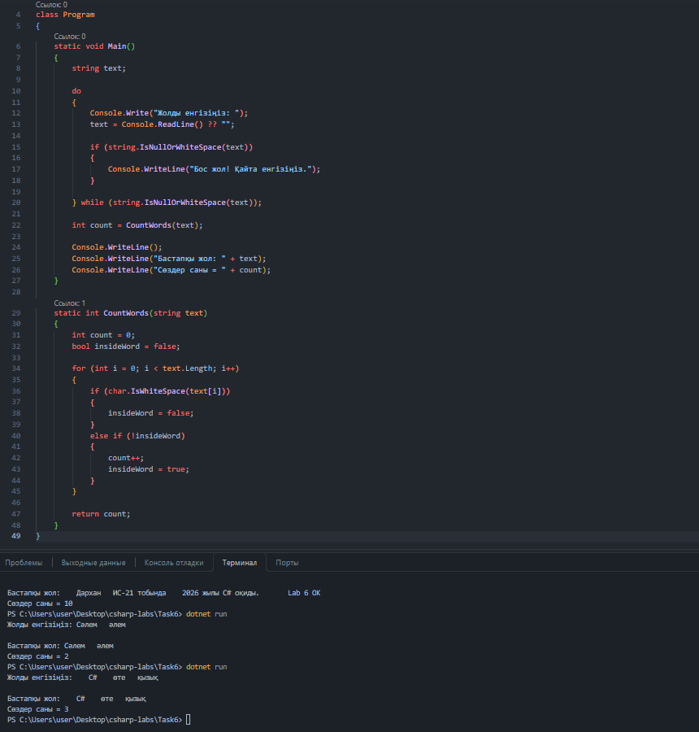

# 6-тапсырма: Символдар тіркесі (1-нұсқа)

**Орындаған:** Чингисхан Дархан  
**Тобы:** ИСк-25-2а  
**Тізімдегі нөмір:** 14  
**6-тапсырма нұсқасы:** 1

## Бағдарламаның мақсаты

Бұл бағдарлама пернетақтадан енгізілген жолдағы сөздердің санын анықтайды.
Сөздер бір немесе бірнеше бос орынмен бөлінуі мүмкін.
Жолдың басында және соңында бос орындар болса да, бағдарлама дұрыс санайды.

## Тест нәтижелері

| Тест | Кіріс | Қолмен есептеген жауап | Бағдарлама жауабы |
|---|---|---:|---:|
| Жеке тест | Жеке тест жолы | 10 | 10 |
| Өз тестім 1 | Сәлем   әлем | 2 | 2 |
| Өз тестім 2 | C#    өте   қызық | 3 | 3 |

## Сұрақтарға жауап

**1. text[i] нені қайтарады, типі қандай? Неге text[i] = 'a'; деп жазуға болмайды?**

text[i] жолдың i индексіндегі символды қайтарады. Оның типі char болады. String өзгермейтін тип болғандықтан, оның ішіндегі символды тікелей өзгертуге болмайды.

**2. Жаңа сөздің басталғанын қалай анықтадыңыз? Жол бос орыннан басталса, программа қате санамай ма?**

Мен insideWord атты логикалық айнымалы қолдандым. Егер символ бос орын болмаса және біз сөздің ішінде тұрмасақ, сөз санын біреуге арттырамыз. Жол басындағы бос орындар есепке алынбайды, сондықтан программа қате санамайды.

**3. result += ch; орындалғанда жаңа жол жасала ма, әлде ескісі өзгере ме?**

String өзгермейтін тип болғандықтан, result += ch; орындалғанда жаңа жол жасалады. Ескі жол өзгеріссіз қалады.

## Кездескен қате

**Қате:** Task6 папкасының ішінде тағы бір Task6 папкасы ашылып кеткен. Соның салдарынан файлдардың орналасуы тапсырма талаптарына сәйкес келмеді.

**Қалай түзеттім:** Артық ішкі Task6 папкасын алып тастап, Program.cs, Task6.csproj және README.md файлдарын бір Task6 папкасының ішіне орналастырдым.

**Түзеткен коммит:** Кейін нақты commit хэшін енгіземін.

## Git

`git log --oneline --graph --all` командасының нәтижесі:

Кейін терминалдан алынған нақты Git log нәтижесін осында енгіземін.

**1. task6 тармағында жасаған коммиттеріңіз main-ге қалай түсті? Біріктіруден кейін task6 тармағы не болды?**

Мен task6 тармағында жұмыс істеп, өзгерістерді бірнеше commit арқылы сақтадым. Кейін GitHub-қа push жасап, Pull Request арқылы main тармағына біріктірдім. Біріктіргеннен кейін task6 тармағы автоматты түрде өшпейді.

**2. commit пен push айырмашылығы неде? Push жасамасаңыз, мұғалім не көреді?**

Commit өзгерістерді компьютердегі Git тарихына сақтайды. Push сол өзгерістерді GitHub-қа жібереді. Push жасамасам, мұғалім GitHub-та соңғы өзгерістерімді көре алмайды.

**3. .gitignore файлына не жаздыңыз және bin/, obj/ неге репозиторийге қосылмайды?**

.gitignore файлына bin/ және obj/ бумаларын қостым. Олар бағдарламаны құрастыру кезінде автоматты түрде жасалатын уақытша файлдар. Сондықтан оларды GitHub-қа жіберудің қажеті жоқ.

## ЖИ қолдану

ChatGPT-ге берген сұрауым:

«C# тілінде 1-нұсқа бойынша жолдағы сөздердің санын табатын бағдарлама жаз. for және do-while циклдерін, жеке әдісті қолдан. Бірнеше бос орын болса да дұрыс сана. Split, Replace, Regex қолданба».

ЖИ ұсынған кодты тапсырма талаптарына сәйкестендіріп, CountWords әдісін және insideWord логикалық айнымалысын қолдандым. Бағдарламаны іске қосып, тест нәтижелерін тексердім.
